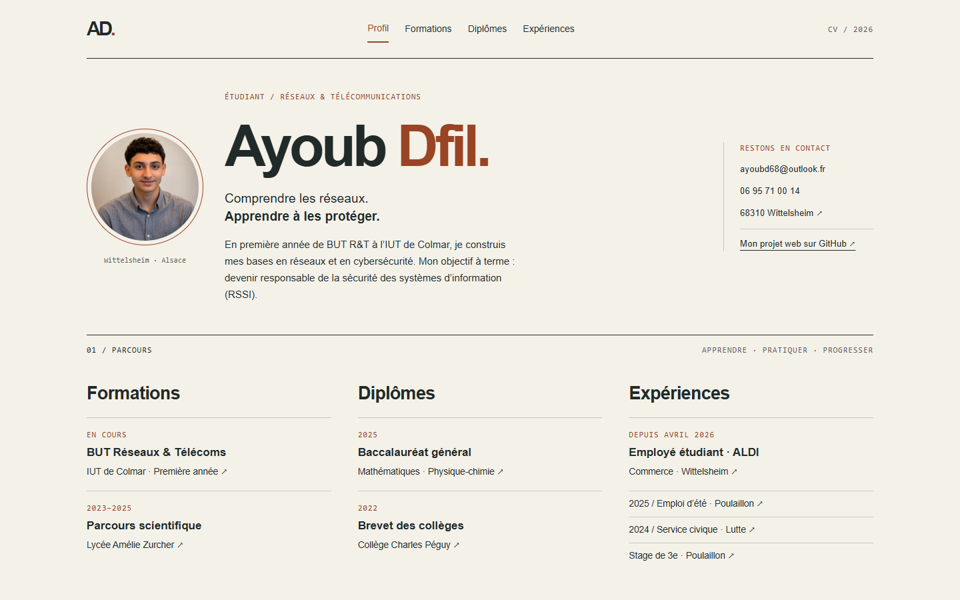

# SAÉ 1.04 — Se présenter sur Internet

## Objectif
Présenter le parcours d’Ayoub Dfil, étudiant en première année de BUT Réseaux et Télécommunications à l’IUT de Colmar, avec un CV web composé de quatre pages.

## Contenu et évolution
Le premier CV réunissait les formations, les diplômes et les expériences. La refonte 2026–2027 corrige sa structure HTML, harmonise les pages secondaires et intègre l’emploi étudiant chez ALDI à Wittelsheim depuis mi-avril 2026. Le BUT reste indiqué comme une formation en cours.

## Choix graphiques
Le site reprend l’idée d’un dossier technique : fond ivoire, texte encre, accents cuivre, repères numérotés et colonnes ouvertes. La photo ronde reste à gauche de la présentation. Les dates, labels et repères utilisent une police monospace, en rappel discret de l’univers informatique.

## Organisation et fonctionnement
- `index.html` synthétise le profil et le parcours.
- `formations.html` développe les études et ce projet.
- `diplomes.html` présente uniquement les diplômes obtenus.
- `experiences.html` détaille les missions professionnelles et associatives.
- `style.css` est partagé par toutes les pages.
- Les images restent dans le même dossier que les pages.

Chaque élément du parcours sur l’accueil pointe vers une ancre précise. Par exemple, `experiences.html#aldi` ouvre la section dont l’identifiant est `aldi`.

## HTML et CSS utilisés
Les balises `header`, `main`, `section`, `article`, `nav`, `aside`, `figure` et `footer` décrivent le rôle des contenus. Les métadonnées précisent notamment l’auteur, les mots-clés et la langue.

Flexbox organise les trois familles de compétences. Grid répartit le portrait, la présentation et les coordonnées, puis les dates et les descriptions sur les pages secondaires. Les règles `@media` adaptent ces dispositions aux écrans étroits. Les couleurs sont regroupées dans des variables CSS pour faciliter les modifications.

## Accessibilité et autonomie
Le site contient un lien d’accès direct au contenu, des textes alternatifs, un focus clavier visible, un état pour la page active, un résumé anglais identifié avec `lang="en"` et une règle réduisant le mouvement. Une mise en forme d’impression est prévue. Il n’y a ni JavaScript, ni framework, ni police distante : le site peut être consulté hors ligne, hors liens externes.

## Méthode et aide
La refonte a été préparée avec une assistance IA pour l’organisation, le code et les vérifications. Les expériences sont issues du CV initial et des précisions d’Ayoub. Le code doit être relu, compris et adapté par son auteur avant présentation.

## Pour expliquer le projet à l’oral
1. Montrer un lien avec ancre et l’identifiant correspondant.
2. Expliquer la différence entre HTML (contenu) et CSS (présentation).
3. Montrer la Flexbox des compétences et une grille de page secondaire.
4. Réduire la fenêtre pour expliquer les règles `@media`.
5. Modifier une variable de couleur pour montrer le rôle de la feuille commune.

## Limites
Aucune mention, moyenne, certification ou expérience technique non fournie n’a été inventée. La rubrique projet décrit ce CV, pas des travaux réseaux supposés. Les liens externes dépendent de sites tiers. Le respect des critères ne garantit pas une note précise.
